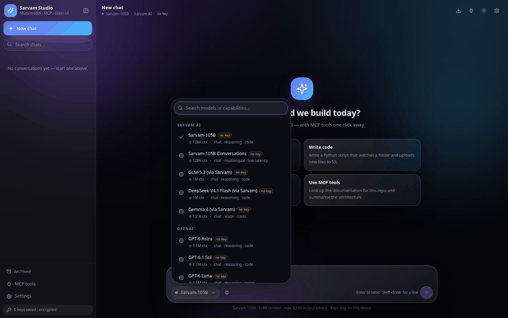
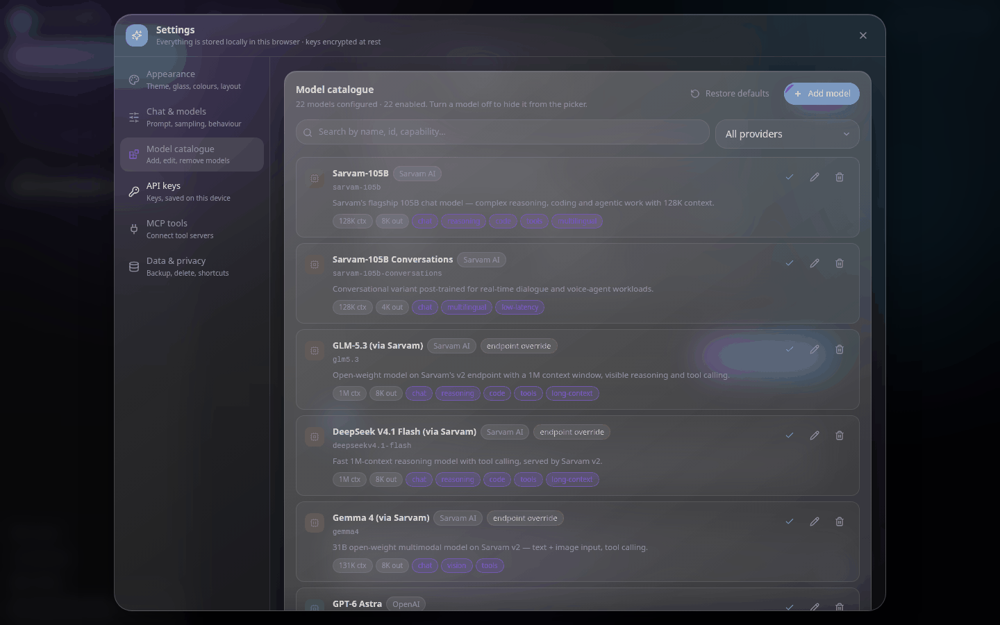
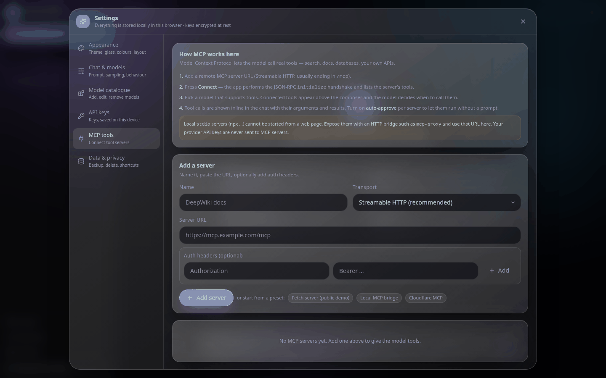
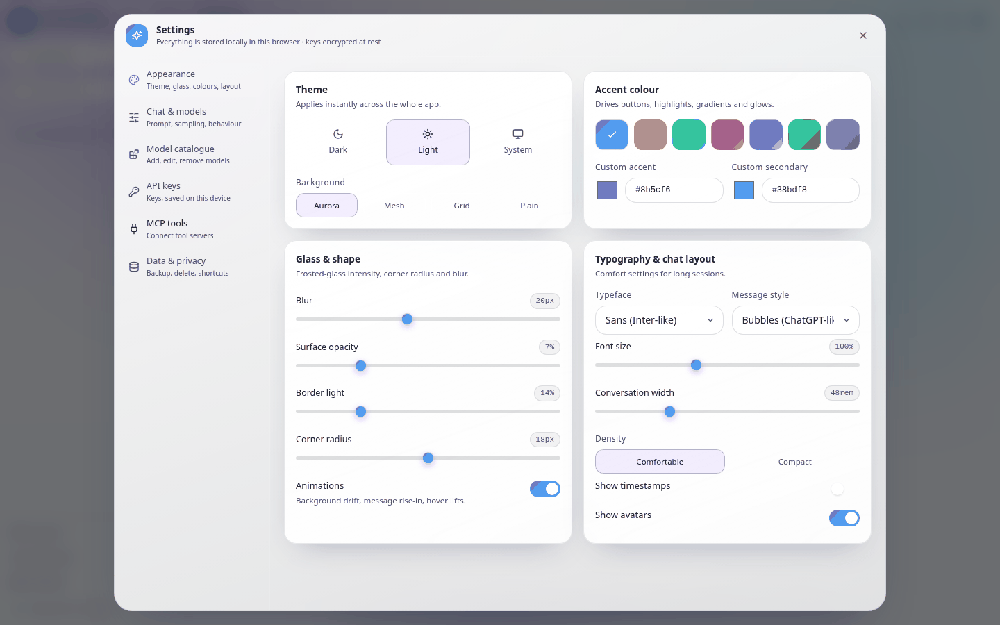
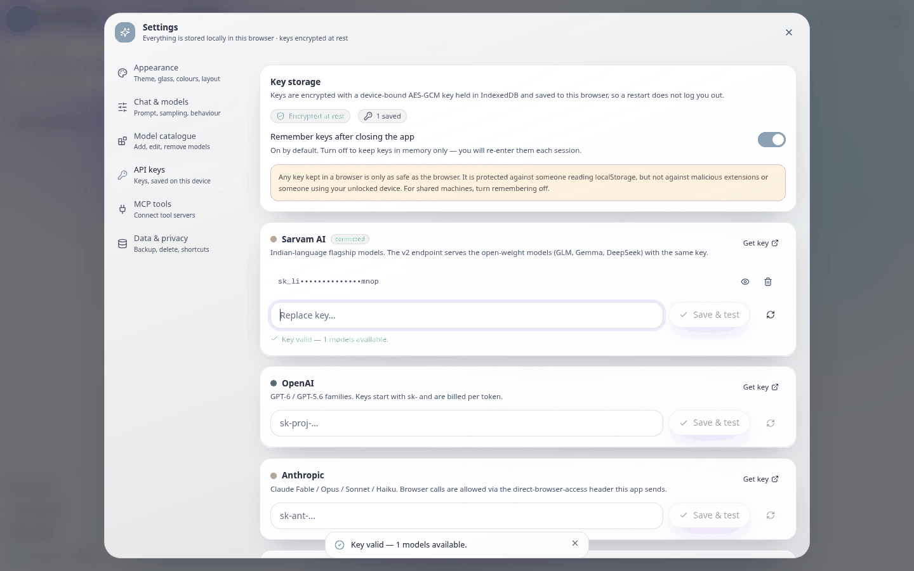
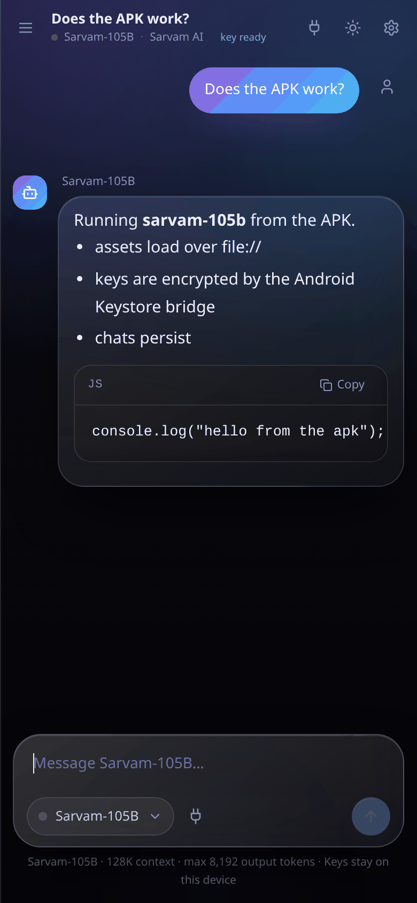
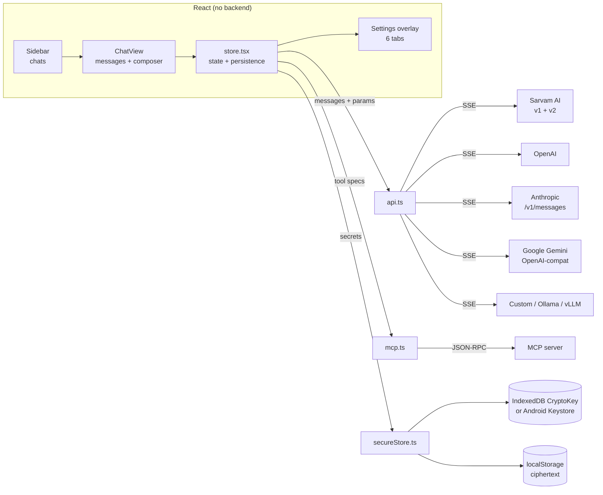

<div align="center">

# Sarvam Studio

**A glass-morphism AI chat studio for Sarvam AI, OpenAI, Anthropic, Google Gemini and any OpenAI-compatible endpoint — with MCP tools, an editable model catalogue, and API keys that survive a restart.**

[](https://www.typescriptlang.org/)
[](https://react.dev/)
[](https://vitejs.dev/)
[](https://tailwindcss.com/)
[](android/README.md)
[](LICENSE)
[](docs/ARCHITECTURE.md)


</div>

---

## What this is

A complete, backend-free AI chat client. Everything runs in your browser (or in the Android WebView):
no server, no database, no build-time secrets, no telemetry. You bring your own provider keys, paste
them once, and they are remembered — encrypted — on your device.

It started as a Sarvam-only demo and was rebuilt into a multi-provider studio: a real streaming client
for five provider families, a genuine MCP client (not a mock), a model catalogue you can edit down to
the token limits, and a theme system where every visual property is a live control.

| | |
| --- | --- |
| **Stack** | React 18 · TypeScript 5.6 · Vite 5 · Tailwind 3.4 · lucide-react |
| **State** | React context + localStorage (no Redux, no Zustand) |
| **Providers** | Sarvam AI · OpenAI · Anthropic · Google Gemini · any OpenAI-compatible endpoint |
| **Transport** | `fetch` + Server-Sent Events, parsed by hand (no SDKs) |
| **Tools** | MCP over Streamable HTTP (JSON-RPC 2.0), legacy HTTP+SSE fallback |
| **Crypto** | WebCrypto AES-GCM (web) · Android Keystore AES-GCM (APK) |
| **Platforms** | Any modern browser · Android 6.0+ (APK) |
| **Backend** | None. |

---

## Screenshots

<table>
<tr>
<td width="50%"><br /><sub><b>Model picker</b> — searchable, grouped by provider, shows context window and capabilities. Flips upward near the screen edge.</sub></td>
<td width="50%"><br /><sub><b>Model catalogue</b> — edit, disable, delete or add models. Retired model IDs are documented, not silently broken.</sub></td>
</tr>
<tr>
<td><br /><sub><b>MCP tools</b> — add a server URL, connect, list tools, per-server auto-approve.</sub></td>
<td><br /><sub><b>Appearance</b> — theme, accent, background, glass blur, radius, typography, density. Light theme shown.</sub></td>
</tr>
<tr>
<td><br /><sub><b>API keys</b> — encrypted at rest, validated against the provider, revealed on demand.</sub></td>
<td><br /><sub><b>Android APK</b> — the same UI, streaming, and persistence in a WebView shell.</sub></td>
</tr>
</table>

---

## Features

### Chat
- Streaming responses with a typing indicator, stop button, and per-message regenerate.
- Markdown renderer written for this app: headings, lists, tables, blockquotes, inline code, and fenced
  code blocks with a copy button — no `dangerouslySetInnerHTML` anywhere.
- Edit any user message and resend from that point (the conversation branches cleanly).
- Copy, delete, timestamps, token counts, and collapsible **reasoning traces** for models that expose them
  (Sarvam v2 GLM/DeepSeek, Anthropic thinking).
- Suggested prompts, keyboard-first composer (Enter / Shift+Enter / Ctrl+Enter, all configurable).

### Conversations
- ChatGPT-style sidebar: **Pinned**, **Today**, **Yesterday**, **Previous 7 days**, **Previous 30 days**.
- Full-text search across titles *and* message bodies.
- Rename inline, pin, archive, delete. Archived chats live in their own view.
- Everything persisted to localStorage on every change; a reload never loses a message.

### Models
- **22 models** across five providers, each with context window, output limit, capabilities, and status.
- Add your own model: ID, display name, provider, context, output cap, capabilities, endpoint override.
- Edit or delete anything, disable a model to hide it from the picker, restore the shipped defaults.
- **Pull the live model list** for your key (OpenAI, Anthropic, Gemini and Sarvam all expose one) and add
  models straight from it.
- Retired model IDs (`sarvam-m`, `sarvam-30b`, older GPT/Claude/Gemini IDs) are documented with migration
  notes instead of being left to fail at request time.

### Providers
- Sarvam AI (v1 **and** v2 endpoints, per-model override), OpenAI, Anthropic, Google Gemini
  (OpenAI-compat layer), and unlimited custom OpenAI-compatible providers (Ollama, LM Studio, vLLM,
  OpenRouter, Groq, Together, a corporate gateway…).
- Per-provider key with validate-on-save, reveal/hide, replace, remove, and a status badge.
- Custom providers: endpoint, models endpoint, auth header name, auth prefix, model list.

### MCP tools
- Real MCP client: `initialize` → `notifications/initialized` → `tools/list` → `tools/call`, over
  Streamable HTTP with an HTTP+SSE fallback.
- Tool definitions are handed to the model as native function tools; a tool-planning round runs first,
  then the results are fed back for a streamed final answer.
- Tool calls render inline in the chat: server, tool, arguments, result, latency.
- Per-server enable/disable, custom auth headers, and **auto-approve** (off by default — calls are
  skipped and reported until you turn it on).

### Appearance
- Dark / light / system themes, seven accent presets or any hex pair, four background styles
  (aurora, mesh, grid, plain).
- Live sliders for glass blur, surface opacity, border light, corner radius, font size, chat width.
- Typeface (sans/serif/mono), density, bubble vs. flat message style, avatars, timestamps, animations.

### Data
- Export the whole workspace (chats, models, providers, MCP servers, settings) to JSON — **keys are never
  included**.
- Import a backup, clear chats, forget keys, or factory-reset.
- Keyboard shortcuts reference built in.

---

## Quick start

### Web

```bash
npm install
npm run dev       # http://localhost:5173
npm run build     # static bundle in dist/
npm run preview   # serve the build
```

Then open **Settings → API keys**, paste a key for the provider you want, hit **Save & test**, and start
chatting. Nothing else to configure.

### Android

```bash
adb install -r SarvamStudio-2.0.apk
```

Or copy the APK to the phone and open it. Rebuild it yourself:

```bash
ANDROID_SDK=~/Android/Sdk ./android/build-apk.sh --web
```

Details, signing, and caveats: [`android/README.md`](android/README.md).

### Deploy

Any static host works — Vercel, Netlify, Cloudflare Pages, GitHub Pages, S3, nginx. The build is a
folder of static files with relative asset paths (`base: "./"`), so it also runs from `file://`.
`.github/workflows/deploy-pages.yml` publishes it to GitHub Pages on every push to `main`.

---

## Models

Model IDs verified against vendor documentation in **October 2026**. Providers retire IDs constantly —
if one stops working, edit or delete it in **Settings → Model catalogue**, or use the ↻ button on the
provider card to pull the live list for your key.

### Sarvam AI
| Model ID | Context | Notes |
| --- | --- | --- |
| `sarvam-105b` | 128K | Flagship — reasoning, coding, agentic work |
| `sarvam-105b-conversations` | 128K | Dialogue-tuned variant for voice agents |
| `glm5.3` | 1M | Open-weight, visible reasoning, tool calling (v2 endpoint) |
| `deepseekv4.1-flash` | 1M | Fast reasoning + tools (v2 endpoint) |
| `gemma4` | 131K | Text + image input, tool calling (v2 endpoint) |

### OpenAI
`gpt-6-astra` (1.05M) · `gpt-6.1-sol` · `gpt-6-luna` · `gpt-5.6-sol` · `gpt-5.6-terra` ·
`gpt-5.6-luna` · `gpt-5.4` *(legacy)*

### Anthropic
`claude-fable-5-1` · `claude-opus-5-5` · `claude-sonnet-5-5` · `claude-haiku-5-5` ·
`claude-opus-4-8` *(legacy)* — all 1M context, 128K output, sent with `anthropic-version: 2026-10-21`
and the direct-browser-access header.

### Google Gemini
`gemini-4-argon` · `gemini-3.8-flash` · `gemini-3.6-flash` · `gemini-3.5-flash-lite` ·
`gemini-3.1-pro-preview`

### Removed on purpose

| Model | Why it is gone |
| --- | --- |
| `sarvam-m` | Deprecated by Sarvam in June 2026 — the API now rejects it outright. Migrate to `sarvam-105b`. |
| `sarvam-30b` | Fully deprecated July 2026. `sarvam-105b` is the only supported Sarvam chat model. |
| `sarvam-105b-32k`, `sarvam-30b-16k` | Fixed-context variants retired; the base IDs serve the full window. |
| `gpt-4o`, `gpt-4.1`, `gpt-5-mini` | Shut down 14 Jan 2027 (GPT-5 / 5-mini: 11 Dec 2026). Use `gpt-6-luna` or `gpt-5.6-terra`. |
| `claude-opus-4-1` | Retired 5 Aug 2026. Use `claude-opus-5-5`. |
| `claude-sonnet-4-5` | Deprecated 30 Sep 2026, retires 30 Nov 2026. Use `claude-sonnet-5-5`. |
| `gemini-3.7-flash`, `gemini-3.5-flash` | Auto-routed to newer Flash IDs; update the model string. |

---

## API keys and what "saved" actually means

The first version of this app kept keys in `sessionStorage`, so every reload asked for them again.
That is fixed. Two storage paths, both real encryption:

**Browser** — a 256-bit AES-GCM key is generated once and stored in IndexedDB as a *non-extractable*
`CryptoKey`. JavaScript cannot read its bytes back out. Each API key is encrypted with it; only
`{iv, ciphertext}` lands in localStorage.

**Android** — `SecureBridge.java` exposes encrypt/decrypt over a `@JavascriptInterface`, backed by an
AES-256 key in the **Android Keystore**. The key material never leaves the keystore, and on devices
with a TEE or StrongBox it is hardware-protected. Uninstalling the app destroys the key.

In both cases the app decrypts on launch, so a restart never asks for a key again. If a browser has
neither path (very old WebView, private-mode restrictions), it degrades to obfuscated localStorage and
the UI says so plainly.

**Honest limits.** This protects against someone reading localStorage, and against a copied storage
dump on another machine. It does **not** protect against malicious code running in the page, a hostile
extension, or someone using your unlocked device. For a shared machine, turn *Remember keys* off —
keys then live in memory only and the stored copies are purged. Keys are never exported in backups and
never sent to MCP servers. For production, keep keys on a server you control.

---

## MCP tools

MCP (Model Context Protocol) is what turns the model from a text generator into something that can act.

1. **Settings → MCP tools → Add a server.** Paste a Streamable-HTTP MCP URL (usually ending in `/mcp`),
   optionally with auth headers.
2. **Connect.** The app performs the JSON-RPC `initialize` handshake, then `tools/list`.
3. **Use it.** Connected tools appear above the composer and are passed to the model as function tools.
   The model decides when to call them; the call, arguments, result and latency render inline.
4. **Auto-approve** per server if you want it to run without asking.

Caveats worth knowing:

- Local `stdio` servers (`npx …`) cannot be started from a web page. Bridge them with something like
  `mcp-proxy` and use that URL.
- Browser CORS applies — the server must allow your origin.
- The APK enables `allowUniversalAccessFromFileURLs`, which is why MCP and provider calls work there
  without a proxy.

---

## Settings reference

| Tab | Controls |
| --- | --- |
| **Appearance** | Theme (dark/light/system) · accent + secondary colour · background style · glass blur / opacity / border · corner radius · animations · typeface · density · message style · font size · chat width · timestamps · avatars |
| **Chat & models** | System prompt (+5 presets) · temperature · top-p · max output tokens · streaming on/off · Enter-to-send · token usage display · context messages · default model · show legacy models |
| **Model catalogue** | Enable/disable · edit (ID, name, provider, status, context, output, capabilities, endpoint override) · delete · add · restore defaults · live model list |
| **API keys** | Per-provider key · save & test · reveal/hide · remove · remember-keys toggle · custom providers CRUD · encryption status |
| **MCP tools** | Add/remove servers · transport · auth headers · connect · tool list · enable · auto-approve |
| **Data & privacy** | Export / import JSON · storage usage · clear chats · forget keys · factory reset · shortcuts |

Every control is wired to real behaviour — there are no decorative toggles.

---

## Architecture



Request lifecycle, in order:

1. `ChatView` builds the message list (system prompt + last *N* messages + the new one).
2. If MCP tools are connected and the model supports tools, one **non-streaming** planning request runs
   with the tool schemas. Tool calls are executed, results appended.
3. The final answer streams over SSE; deltas update the assistant message on every chunk.
4. Reasoning deltas (`reasoning_content`, `thinking_delta`) go to a separate collapsible block.
5. Usage is captured when the provider sends it; the message and conversation are persisted.

Deep dive: [`docs/ARCHITECTURE.md`](docs/ARCHITECTURE.md).

---

## Project structure

```
.
├── index.html
├── package.json
├── vite.config.ts            base: "./" so the build runs from file:// too
├── tailwind.config.js
├── tsconfig.json
├── src
│   ├── main.tsx
│   ├── App.tsx               shell: background, sidebar, top bar, overlays
│   ├── index.css             design tokens + glass system + light-theme tuning
│   ├── components
│   │   ├── Sidebar.tsx       chats: pin, archive, rename, search, delete
│   │   ├── ChatView.tsx      messages, composer, send / stream / tool loop
│   │   ├── ModelPicker.tsx   searchable model menu
│   │   ├── SettingsOverlay.tsx
│   │   ├── Toast.tsx
│   │   ├── ui.tsx            Button, Input, Select, Switch, Slider, Modal, Badge…
│   │   └── panels            Appearance · Chat · Models · Providers · MCP · Data
│   └── lib
│       ├── catalog.ts        providers, 22 models, retired-model notes
│       ├── api.ts            request bodies, SSE parsing, tool calls, key validation
│       ├── mcp.ts            MCP client (Streamable HTTP + SSE fallback)
│       ├── secureStore.ts    WebCrypto + Android Keystore key storage
│       ├── store.tsx         app state, persistence, hydration
│       ├── markdown.tsx      safe markdown + code blocks
│       ├── types.ts          settings, conversations, messages
│       └── cn.ts             class merge, dates, masking
├── android                   APK project (no Gradle)
│   ├── AndroidManifest.xml
│   ├── java/ai/sarvam/studio/{MainActivity,SecureBridge}.java
│   ├── res                   adaptive icon, theme, strings
│   ├── assets/www            the built web app
│   ├── keystore              self-signed key for this build
│   └── build-apk.sh          aapt2 → javac → d8 → zipalign → apksigner
├── docs
│   ├── ARCHITECTURE.md
│   └── screenshots
└── SarvamStudio-2.0.apk      ready to install
```

---

## Development

```bash
npm install
npm run dev        # vite dev server
npm run build      # tsc -b && vite build
npm run preview    # preview the production build
npx tsc -b         # typecheck only
```

CI runs typecheck + build on every push (`.github/workflows/ci.yml`).

### What was actually verified

- `tsc -b` clean on strict mode.
- 16 logic assertions against mocked HTTP: SSE parsing for both API shapes, Anthropic usage events,
  tool-call parsing, error classification (401/404/429/5xx), MCP handshake + `tools/call`, and the
  secret store round-trip.
- Browser end-to-end with a mocked provider: key saved and validated, streamed reply rendered with
  markdown and a code block, then **chat and key both survived a reload**.
- APK: signature verified (v1/v2/v3), manifest and launcher activity checked, and the packaged assets
  run from a `file://` origin in Chromium — the same engine and origin the WebView uses.
- Not verified: a real boot on Android hardware, and live calls to each provider (that needs your keys).

---

## Limitations and honest notes

- **CORS is the provider's decision.** A few endpoints refuse browser origins. Every model has an
  *endpoint override*, so you can point it at your own proxy; `.env.example` has a `VITE_SARVAM_PROXY_URL`
  hook for that.
- **Model IDs rot.** Vendors retire them; that is why the catalogue is editable and why the retired list
  exists.
- **Client-side keys are a compromise.** Fine for a personal tool, wrong for a multi-tenant product.
- **No offline inference.** Every request goes to the provider you configured.
- **Speech-to-text / TTS are not wired in**, even though Sarvam offers them (Saaras, Bulbul).
- The APK is signed with a throwaway debug key — replace it before publishing anywhere.

## Roadmap

- [ ] Image attachments (Gemini/Sarvam `gemma4` and the GPT/Claude vision models already accept them)
- [ ] Speech input via Sarvam Saaras + spoken replies via Bulbul
- [ ] Prompt library and reusable snippets
- [ ] Per-conversation overrides (system prompt, temperature)
- [ ] Cost estimator per message from the pricing table
- [ ] MCP prompt templates and resources (currently tools only)

## Contributing

Issues and pull requests are welcome. Please keep the no-backend constraint: any feature must work with
keys held on the client. Run `npx tsc -b` before opening a PR.

## License

[MIT](LICENSE) © Samir Sayyad

Model names and API endpoints belong to their respective vendors. This project is not affiliated with
Sarvam AI, OpenAI, Anthropic or Google.
