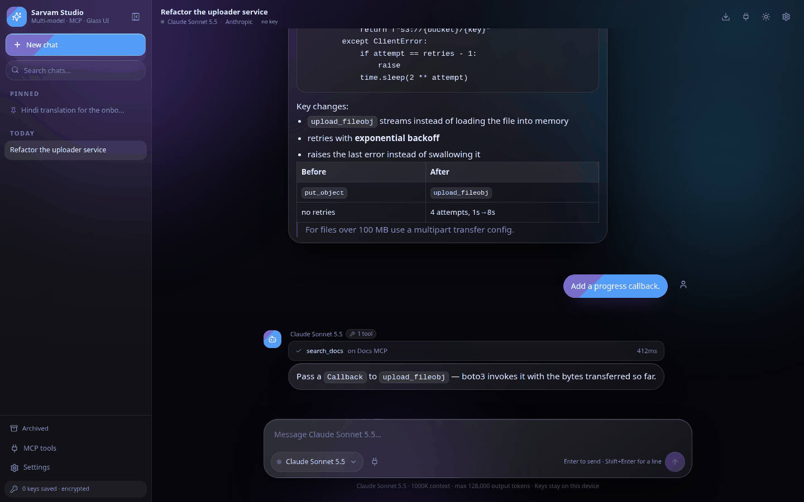
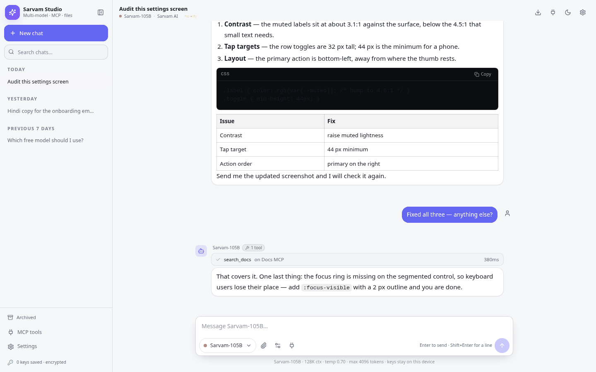
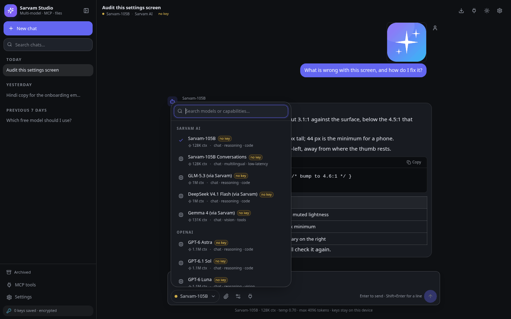
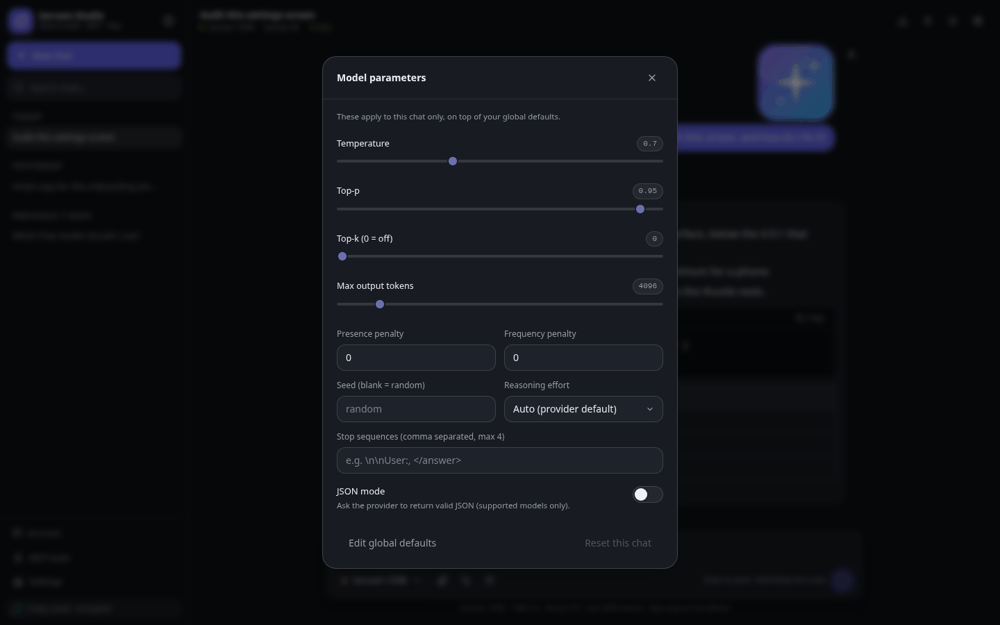
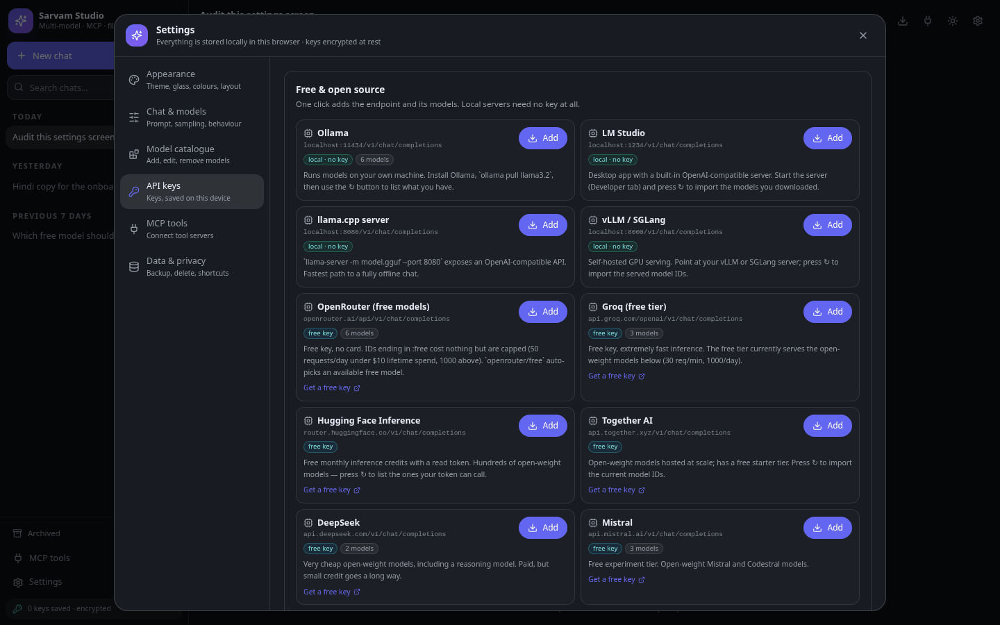
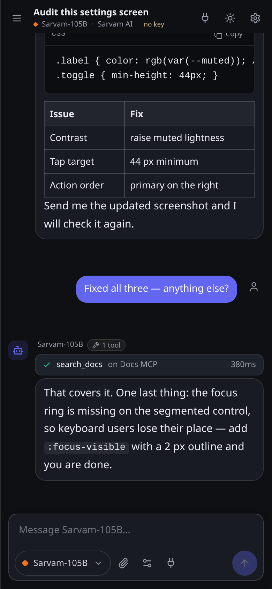
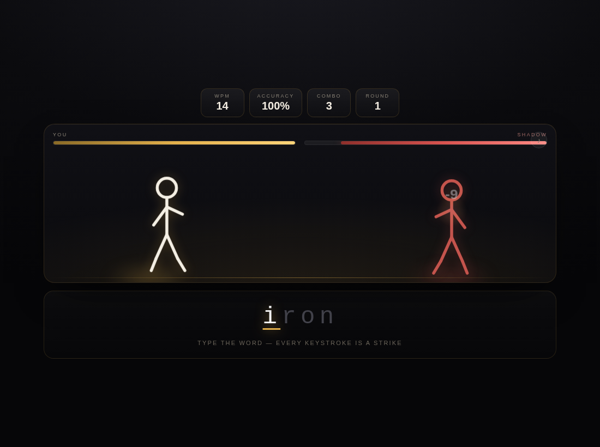
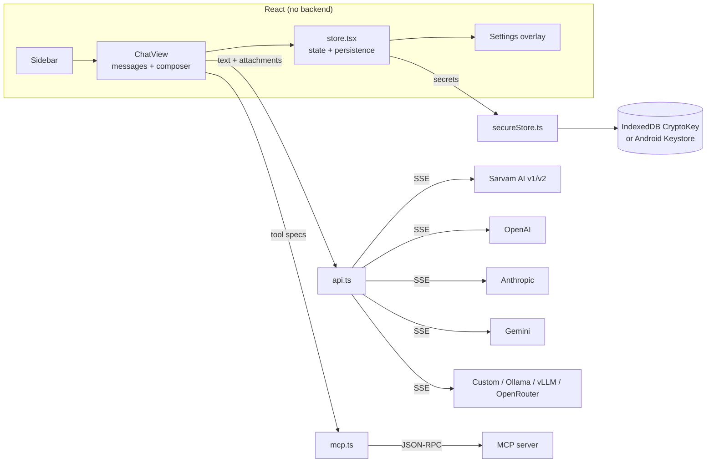

<div align="center">

# Sarvam Studio

**A fast, flat, multi-model AI chat app for Sarvam AI, OpenAI, Anthropic, Google Gemini and any OpenAI-compatible endpoint — with image and file attachments, MCP tools, free open-source model presets, and API keys that survive a restart.**

[](https://www.typescriptlang.org/)
[](https://react.dev/)
[](https://vitejs.dev/)
[](docs/ARCHITECTURE.md)
[](android/README.md)
[](LICENSE)
[](docs/ARCHITECTURE.md)



</div>

---

## What this is

A complete AI chat client with no backend: no server, no database, no build-time secrets, no telemetry.
You paste your own provider key once, it is encrypted on your device, and it stays there across restarts.

Version 3 is a performance and capability pass on top of v2:

- **The glass layer is gone.** Backdrop-filter surfaces, animated background blobs and the blur on every
  panel were the biggest cost on mid-range phones. The UI is now flat: solid fills, 1px borders, one
  cheap gradient. Same layout, roughly a third of the paint work.
- **Streaming is batched per animation frame** instead of per token, message rows are memoised, and
  off-screen messages use `content-visibility: auto`, so a long conversation no longer re-renders the
  whole transcript on every chunk.
- **You can send images and files**, and models can send images back.
- **Free and open-source models are one click away** — local servers (Ollama, LM Studio, llama.cpp,
  vLLM) and free hosted tiers (OpenRouter, Groq, Hugging Face, Together, DeepSeek, Mistral, Cerebras,
  GitHub Models).
- **Every sampling knob a chat app needs**: temperature, top-p, top-k, penalties, seed, stop sequences,
  reasoning effort, JSON mode, max tokens — as global defaults and per-chat overrides.

| | |
| --- | --- |
| **Stack** | React 18 · TypeScript 5.6 · Vite 5 · Tailwind 3.4 · lucide-react |
| **Bundle** | ~97 KB gzipped (JS + CSS), no UI framework, no state library |
| **State** | One React context + localStorage |
| **Providers** | Sarvam AI · OpenAI · Anthropic · Google Gemini · any OpenAI-compatible endpoint · 12 free/open-source presets |
| **Transport** | `fetch` + hand-written SSE parser (no SDKs) |
| **Tools** | MCP over Streamable HTTP (JSON-RPC 2.0), legacy HTTP+SSE fallback |
| **Crypto** | WebCrypto AES-GCM (web) · Android Keystore AES-GCM (APK) |
| **Platforms** | Any modern browser · Android 6.0+ (APK) |
| **Backend** | None. |

---

## Screenshots

<table>
<tr>
<td width="50%"><br /><sub><b>Light theme</b> — flat surfaces, an attached screenshot, Markdown, tables and code blocks.</sub></td>
<td width="50%"><br /><sub><b>Model picker</b> — searchable, grouped by provider, shows context window, capabilities and whether a key is configured.</sub></td>
</tr>
<tr>
<td><br /><sub><b>Parameters</b> — temperature, top-p, top-k, penalties, seed, stop sequences, reasoning effort, JSON mode. Per chat, over global defaults.</sub></td>
<td><br /><sub><b>Free & open source</b> — one click adds an endpoint and its models. Local servers need no key.</sub></td>
</tr>
<tr>
<td colspan="2"><br /><sub><b>Android</b> — the same UI in the APK, with Keystore-backed key encryption.</sub></td>
</tr>
</table>

---

## Built with this app

Real output, not mockups. [`examples/`](examples/) holds projects that were written by the model inside
this app and shipped as-is.

<table>
<tr>
<td width="46%"></td>
<td>

**TypeFight — Typing Duel** · [live](https://stickma.netlify.app) · [source](examples/typefight/)

A one-file typing game: every correct keystroke lands a hit on a stickman, finishing a word triggers a
finisher, a wrong key or a stall lets Shadow strike back. Rounds scale, HP grows, sound is synthesised
with the Web Audio API.

35 KB of HTML with inline CSS and JS. No build step, no dependencies, deployed to Netlify unchanged.

</td>
</tr>
</table>

---

## Features

### Talk mode
- **Speak your message** — the mic records up to 30 s and transcribes with Sarvam Saaras
  (`saaras:v4`) or the browser's speech engine; auto-send or edit the transcript first. Recordings are
  re-encoded to 16 kHz mono WAV before upload, because the API rejects webm/opus.
- **Hear replies** — a speaker toggle reads answers with the phone's voices, choosing the language
  from the script of the text, with a rate slider.
- Speech-to-text language picker: auto-detect plus 13 Indian languages.

### Multitasking and voice mode
- **Several chats answer at once** — each conversation keeps its own stream, with a running count and
  a Stop all above the composer.
- **Voice mode** — hands-free listen → transcribe → send → speak loop in a full-screen sheet, plus a
  per-message mic and a read-aloud toggle.

### Chat
- **Auto model** — one entry in the picker that chooses the best available model per message
  (filters on image input, tool calling and context, then prefers the provider's flagship).
- **File cards** on replies: every code block becomes a real file with Download · Open · Share.
- Token streaming batched per animation frame, with a stop button and per-message regenerate.
- Markdown written for this app: headings, lists, tables, blockquotes, inline code, fenced code blocks
  with a copy button — rendered to React elements, never `dangerouslySetInnerHTML`.
- Edit any user message and resend from that point.
- Collapsible **reasoning traces** for models that expose them (Sarvam v2 GLM/DeepSeek, Anthropic thinking).
- Token counts, timestamps, copy, delete, and a stop state that is visible rather than silent.

### Files and images
- **Send images** — picker, drag-and-drop or paste from the clipboard. Images are downscaled to 1280 px
  in the browser (a 6 MB photo becomes ~150 KB) before they are stored or sent.
- **Send text files** — `.txt`, `.md`, `.json`, `.csv`, code files and similar are read as text and
  inlined into the prompt, so even text-only models can use them.
- **Send a `.zip`** — text and code files inside it are extracted in the browser and inlined
  (up to 25 files / 400 KB); binaries inside the archive are skipped.
- **Receive images** — anything the model returns as an image renders inline (Markdown images, array
  content parts, `images[]`), with a click-to-zoom lightbox and a download button.
- Attachments are persisted with the message; if storage runs out, image payloads are shed first so the
  conversation text is never lost.

### Free and open-source models
Twelve one-click presets, each of which creates the provider and imports its models:

| Local (no key, no cloud) | Hosted free tier (free key) |
| --- | --- |
| Ollama · LM Studio · llama.cpp server · vLLM / SGLang | OpenRouter (`:free` models + `openrouter/free` router) · Groq · Hugging Face Inference · Together · DeepSeek · Mistral · Cerebras · GitHub Models |

Every provider card has a ↻ button that pulls the **live model list** for your key — the reliable way to
see what a gateway currently serves, because hosted model IDs rotate constantly.

### Model parameters
Global defaults in Settings, per-chat overrides from the composer:

`temperature` · `top_p` · `top_k` · `max_tokens` · `presence_penalty` · `frequency_penalty` · `seed` ·
`stop` (up to 4) · `reasoning_effort` (auto/low/medium/high) · JSON mode · `max_tokens`
(auto = the model's own documented limit, or manual up to **2,000,000**)

Each is mapped to the right field per provider (Anthropic gets `stop_sequences` and `top_k`, OpenAI
reasoning models get `max_completion_tokens` and `reasoning_effort`, Sarvam v2 gets `low/high/max`).

### Models and providers
- 22 shipped models with context windows, output limits, capabilities and status.
- Add, edit, disable or delete any model; restore the shipped set; import from a live model list.
- Retired model IDs (`sarvam-m`, `sarvam-30b`, older GPT/Claude/Gemini IDs) are documented with
  migration notes instead of failing at request time.

### Conversations
- ChatGPT-style sidebar: pinned, today, yesterday, previous 7 / 30 days.
- Search across titles and message bodies; rename, pin, archive, delete.
- Everything persisted on every change — a reload never loses a message.

### MCP tools
- **Open-source catalogue** — twelve community servers: DeepWiki, Cloudflare Docs, Context7 and GitMCP
  connect straight from the page; Filesystem, Git, Memory, Sequential thinking, Fetch, SQLite, Puppeteer
  and GitHub come with a copy-ready `supergateway` bridge command.
- Real MCP client: `initialize` → `notifications/initialized` → `tools/list` → `tools/call`.
- Tools are handed to the model as native function tools; results feed a streamed follow-up answer.
- Tool calls render inline with server, arguments, result and latency.
- Per-server enable/disable, auth headers, and **auto-approve** (off by default).

### Appearance
- **Mocha & gold palette** (mocha `#5B4632` surfaces, champagne `#F4D9A0`, burnt amber `#C8792C`) or
  neutral graphite — in dark and light.
- Dark / light / system, seven accent presets or any hex pair, three background styles.
- Live controls for surface contrast, border strength, corner radius, font size, chat width, typeface,
  density, message style, avatars, timestamps and animations.

### Data
- Export/import the whole workspace as JSON — **keys are never included**.
- Clear chats, forget keys, factory reset, storage usage, shortcut reference.

---

## Quick start

### Web

```bash
npm install
npm run dev       # http://localhost:5173
npm run build     # static bundle in dist/
npm run preview   # serve the build
```

Open **Settings → API keys**, paste a key (or press **Add** on a free/local preset), then chat.

### Android

```bash
adb install -r SarvamStudio-3.0.apk
```

Rebuild it yourself: `ANDROID_SDK=~/Android/Sdk ./android/build-apk.sh --web` — see
[`android/README.md`](android/README.md).

### Deploy

Any static host. The build uses relative asset paths (`base: "./"`), so it also runs from `file://`.
`.github/workflows/deploy-pages.yml` publishes to GitHub Pages on every push to `main`.

---

## Models

Model IDs verified against vendor documentation in **October 2026**. Providers retire IDs constantly —
if one stops working, edit it in **Settings → Model catalogue** or use ↻ on the provider card.

### Sarvam AI
| Model ID | Context | Notes |
| --- | --- | --- |
| `sarvam-105b` | 128K | Flagship — reasoning, coding, agentic work |
| `sarvam-105b-conversations` | 128K | Dialogue-tuned variant for voice agents |
| `glm5.3` | 1M | Open-weight, visible reasoning, tool calling (v2 endpoint) |
| `deepseekv4.1-flash` | 1M | Fast reasoning + tools (v2 endpoint) |
| `gemma4` | 131K | Text + image input, tool calling (v2 endpoint) |

### OpenAI
`gpt-6-astra` (1.05M) · `gpt-6.1-sol` · `gpt-6-luna` · `gpt-5.6-sol` · `gpt-5.6-terra` ·
`gpt-5.6-luna` · `gpt-5.4` *(legacy)*

### Anthropic
`claude-fable-5-1` · `claude-opus-5-5` · `claude-sonnet-5-5` · `claude-haiku-5-5` ·
`claude-opus-4-8` *(legacy)* — 1M context, 128K output, `anthropic-version: 2026-10-21`.

### Google Gemini
`gemini-4-argon` · `gemini-3.8-flash` · `gemini-3.6-flash` · `gemini-3.5-flash-lite` ·
`gemini-3.1-pro-preview`

### Removed on purpose

| Model | Why it is gone |
| --- | --- |
| `sarvam-m` | Deprecated by Sarvam in June 2026 — the API rejects it outright. Use `sarvam-105b`. |
| `sarvam-30b` | Fully deprecated July 2026. |
| `sarvam-105b-32k`, `sarvam-30b-16k` | Fixed-context variants retired. |
| `gpt-4o`, `gpt-4.1`, `gpt-5-mini` | Shut down 14 Jan 2027 (GPT-5 / 5-mini: 11 Dec 2026). |
| `claude-opus-4-1` | Retired 5 Aug 2026. |
| `claude-sonnet-4-5` | Deprecated 30 Sep 2026, retires 30 Nov 2026. |
| `gemini-3.7-flash`, `gemini-3.5-flash` | Auto-routed to newer Flash IDs. |

---

## API keys and what "saved" actually means

**Browser** — a 256-bit AES-GCM key is generated once and kept in IndexedDB as a *non-extractable*
`CryptoKey`; JavaScript cannot read its bytes back out. Each API key is encrypted with it, and only
`{iv, ciphertext}` lands in localStorage.

**Android** — `SecureBridge.java` exposes encrypt/decrypt over a `@JavascriptInterface` backed by an
AES-256 key in the **Android Keystore**. The key never leaves the keystore, and on devices with a TEE
or StrongBox it is hardware-protected.

Both paths decrypt on launch, so a restart never asks for a key again. If neither is available the app
degrades to obfuscated localStorage and says so in the UI.

**Honest limits.** This protects against someone reading localStorage and against a copied storage dump.
It does **not** protect against malicious code in the page, a hostile extension, or an unlocked device.
For a shared machine, turn *Remember keys* off. Keys are never exported and never sent to MCP servers.

---

## Architecture



Request lifecycle:

1. `ChatView` builds the message list — system prompt, last *N* turns, and the new message with its
   attachments converted to provider-shaped parts.
2. If MCP tools are connected, one non-streaming planning request runs with the tool schemas; calls are
   executed and results appended.
3. The answer streams over SSE; deltas are buffered and flushed once per animation frame.
4. Reasoning deltas go to a separate collapsible block; usage is captured when sent.
5. The conversation is persisted (shedding image payloads first if storage is full).

Deep dive: [`docs/ARCHITECTURE.md`](docs/ARCHITECTURE.md).

---

## Project structure

```
├── src
│   ├── App.tsx                 shell: background, sidebar, top bar, overlays
│   ├── index.css               flat design tokens (no blur, no animated layers)
│   ├── components
│   │   ├── ChatView.tsx        messages, composer, attachments, rAF streaming, params
│   │   ├── Sidebar.tsx         chats: pin, archive, rename, search, delete
│   │   ├── ModelPicker.tsx     searchable model menu
│   │   ├── SettingsOverlay.tsx six-tab settings shell
│   │   ├── Toast.tsx · ui.tsx  primitives
│   │   └── panels              Appearance · Chat · Models · Providers · MCP · Data
│   └── lib
│       ├── catalog.ts          providers, 22 models, 12 free/OSS presets
│       ├── api.ts              request bodies, SSE, attachments, tools, validation
│       ├── attach.ts           image downscaling, text extraction
│       ├── mcp.ts              MCP client (Streamable HTTP + SSE fallback)
│       ├── secureStore.ts      WebCrypto + Android Keystore key storage
│       ├── store.tsx           state, persistence, quota handling
│       ├── markdown.tsx        safe markdown, images, lightbox
│       └── types.ts · cn.ts
├── android                     APK project (no Gradle)
├── docs                        ARCHITECTURE.md + screenshots
└── SarvamStudio-3.0.apk        ready to install
```

---

## Development

```bash
npm install
npm run dev        # vite dev server
npm run build      # tsc -b && vite build
npx tsc -b         # typecheck only
```

CI runs typecheck + build on every push.

### What was actually verified

- `tsc -b` clean in strict mode.
- Browser end-to-end against a mocked provider: an image and a text file attached, the request body
  inspected (1 image part + 1 text part, `top_k`/`presence_penalty`/`seed` all present), the streamed
  reply rendered, an image in the reply displayed, and the chat persisted across a reload.
- Free-preset flow: pressing **Add** on Ollama created the provider, imported 6 models and they appeared
  in the picker.
- APK: signature verified (v1/v2/v3), and the packaged assets run from a `file://` origin in Chromium —
  the same engine and origin the WebView uses.
- Not verified: a boot on real Android hardware, and live calls to each provider (needs your keys).

---

## Limitations and honest notes

- **CORS is the provider's decision.** Every model has an endpoint override so you can point it at your
  own proxy; `.env.example` has a `VITE_SARVAM_PROXY_URL` hook.
- **Model IDs rot.** That is why the catalogue is editable and why the retired list exists.
- **Free tiers are rate-limited** (OpenRouter: 50 requests/day under $10 lifetime spend, 1000 above;
  Groq: 30 req/min, 1000/day). The app surfaces 429s but cannot raise the cap.
- **Images need a vision model.** Sending a picture to a text-only model just inlines the file name.
- **Client-side keys are a compromise** — fine for a personal tool, wrong for a multi-tenant product.
- **No offline inference.** Local presets need a local server running; the app never bundles weights.
- Speech-to-text / TTS are not wired in.
- The APK is signed with a throwaway debug key — replace it before publishing anywhere.

## Roadmap

- [x] Image and file attachments, images in replies
- [x] Free & open-source presets, full sampling parameters
- [ ] Speech input via Sarvam Saaras, spoken replies via Bulbul
- [ ] Prompt library and reusable snippets
- [ ] Cost estimate per message from the pricing table
- [ ] MCP prompt templates and resources (tools only today)

## License

[MIT](LICENSE) © Samir Sayyad

Model names and API endpoints belong to their respective vendors. Not affiliated with Sarvam AI, OpenAI,
Anthropic or Google.
