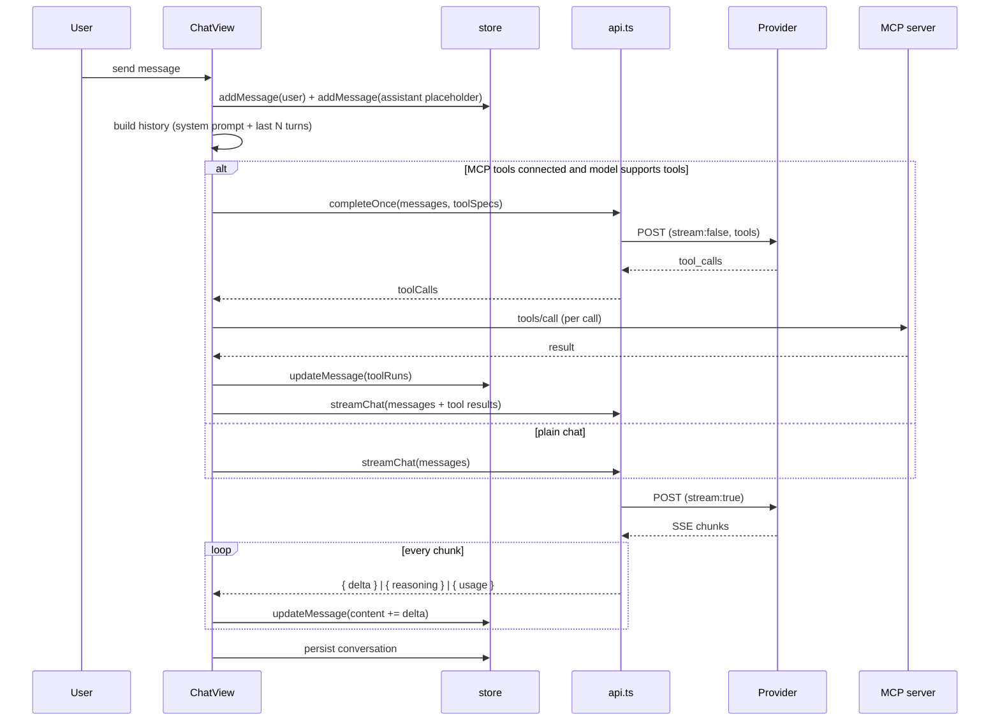

# Architecture

How Sarvam Studio is put together, and why it is built this way.

The constraint that shapes everything: **there is no backend**. Every request leaves the user's device
straight to the provider, every byte of state lives in the browser (or the app's WebView), and every
secret is encrypted on the client. Features that would need a server — shared history, team keys, usage
billing, a proxy for CORS-hostile APIs — are out of scope by design.

---

## 1. Layers

```
┌──────────────────────────────────────────────────────────────┐
│  Presentation                                                │
│  App.tsx · Sidebar · ChatView · ModelPicker · SettingsOverlay│
│  panels/{Appearance,Chat,Models,Providers,Mcp,Data}          │
├──────────────────────────────────────────────────────────────┤
│  State                                                       │
│  lib/store.tsx — one React context, useCallback actions,     │
│  localStorage persistence, async key hydration               │
├──────────────────────────────────────────────────────────────┤
│  Domain                                                      │
│  lib/catalog.ts (providers + models)                         │
│  lib/api.ts     (request shapes, SSE, tools, validation)     │
│  lib/mcp.ts     (JSON-RPC client)                            │
│  lib/secureStore.ts (encryption)                             │
├──────────────────────────────────────────────────────────────┤
│  Platform                                                    │
│  fetch · EventSource-style SSE · WebCrypto · IndexedDB       │
│  localStorage · Android Keystore (via JS bridge, APK only)   │
└──────────────────────────────────────────────────────────────┘
```

No state library. The app has one store because the state is genuinely one object graph: settings affect
model selection, model selection determines which key is used, keys and MCP servers are shared across
conversations. A single context with narrow actions keeps that honest, and avoids the prop-drilling a
component-local approach would force.

---

## 2. Data model

```ts
Conversation { id, title, messages[], modelId, createdAt, updatedAt, pinned?, archived? }

ChatMsg {
  id, role: "user" | "assistant", content, createdAt,
  modelId?,            // which model produced this reply
  error?,              // rendered as an error bubble
  reasoning?,          // collapsible thinking trace
  toolRuns?,           // inline MCP call traces
  usage?,              // { prompt, completion } tokens
  stopped?             // user pressed stop
}

ModelDef {
  id, name, provider, description, contextWindow, maxTokens,
  capabilities[], endpoint?,   // per-model override (Sarvam v2, proxies)
  status, pricing?, builtin?, enabled?, providerRef?
}

Settings { …theme, glass, typography, sampling, behaviour, storage… }
```

Everything above is JSON-serialisable and lives in `localStorage` under versioned keys
(`sarvam.v2.*`). Secrets live separately, encrypted (see §7).

---

## 3. Request lifecycle



Two details worth calling out:

**Tool planning is a separate, non-streaming round.** Mixing tool-call detection with token streaming
means buffering partial JSON arguments and hoping the model finishes before the user sees anything. One
cheap non-streaming request decides whether tools are needed at all; if the model answers directly, that
answer is used as-is and no second request is made. Only when tools are actually called does a streamed
follow-up run — so the common path costs exactly one request.

**Reasoning is a separate channel.** Sarvam v2 (`reasoning_content`), DeepSeek and Anthropic
(`thinking_delta`) emit their thinking alongside content. It is accumulated into `msg.reasoning` and
rendered in a collapsed block, so the answer stays readable and the trace is one click away.

---

## 4. Provider adapters

`api.ts` normalises five families into two wire formats.

| Provider | Format | Auth | Notes |
| --- | --- | --- | --- |
| Sarvam AI | OpenAI chat-completions | `api-subscription-key` (+ `Authorization` for compat) | v1 for `sarvam-105b*`, v2 for open-weight models |
| OpenAI | OpenAI chat-completions | `Authorization: Bearer` | sends `max_completion_tokens` (the modern field for reasoning models) |
| Anthropic | Messages API | `x-api-key` + `anthropic-version: 2026-10-21` + `anthropic-dangerous-direct-browser-access` | system prompt is hoisted out of `messages`; `max_tokens` is mandatory |
| Google Gemini | OpenAI-compat layer | `Authorization: Bearer` | same body shape, different host |
| Custom | OpenAI chat-completions | configurable header + prefix | Ollama, vLLM, OpenRouter, gateways |

Endpoint resolution order: **model-level override → custom provider config → provider default**. That is
what lets one provider (Sarvam) serve two endpoints, and what lets a user route a single stubborn model
through their own proxy without touching anything else.

### Streaming parser

One hand-written SSE reader for both shapes. It buffers on newlines, keeps a partial tail between
`read()` calls, tolerates malformed chunks, and maps:

- OpenAI-ish → `choices[0].delta.content`, `delta.reasoning_content`, `usage`
- Anthropic → `content_block_delta` (`text_delta` / `thinking_delta`), `message_delta.usage`

Abort is cooperative: an `AbortController` cancels the fetch, the loop exits, and the message is marked
`stopped` rather than `error`.

### Error mapping

HTTP status is translated into something a human can act on before it reaches the UI:
401/403 → "check the key", 402 → "out of credit", 404 → "this model ID may have been retired",
429 → "rate limit", 400/422 → provider message, 5xx → "temporarily unavailable". A network failure is
reported as a CORS-or-network problem with the proxy hint, because in a browser that is nearly always
what it is.

---

## 5. MCP client

`mcp.ts` speaks JSON-RPC 2.0 over Streamable HTTP:

1. `POST initialize` with protocol version `2025-06-18`, capture `mcp-session-id` from the response.
2. `POST notifications/initialized` (fire and forget).
3. `POST tools/list` → `{ name, description, inputSchema }`.
4. `POST tools/call` → content blocks flattened to text.

Responses are accepted as `application/json` **or** `text/event-stream` (the reader pulls the last
complete JSON-RPC payload out of the SSE body). Legacy HTTP+SSE servers are supported by opening the
stream once to discover the `endpoint` event and posting there afterwards.

Tool names are namespaced per server (`server__tool`, sanitised to `[A-Za-z0-9_-]`, ≤60 chars) so two
servers can expose `search` without colliding, and mapped back before the call.

Safety: `autoApprove` is **off** by default. Without it, a tool call is reported as skipped rather than
executed — the model is told it was skipped and answers from what it has. Nothing on the MCP path ever
receives the provider API key.

---

## 6. Design system

Every visual property is a CSS custom property on `:root`, written by the store when settings change:

```
--accent, --accent-2      rgb triplets, so Tailwind's /alpha works
--glass-blur, --glass-alpha, --glass-border
--radius, --font-scale, --chat-width
--bg-0, --bg-1, --bg-1-t, --fg, --muted, --panel, --shadow
```

Changing the accent, blur or radius re-paints the whole app without re-rendering the React tree — the
reason the appearance sliders feel instant.

Glass surfaces are three classes: `.glass` (panels), `.glass-soft` (nested), `.glass-hi` (composer,
modals). Light theme overrides them with a denser surface, because white-on-white glass loses all
definition. Popovers (`.popover`) are deliberately **opaque** — a menu you can read the page through is a
menu you cannot read.

Markdown renders to React elements, never HTML strings: no `dangerouslySetInnerHTML`, so a model cannot
inject markup into the app.

---

## 7. Security model

| Threat | Mitigation |
| --- | --- |
| Someone reads localStorage | Keys are AES-GCM ciphertext; the key is a non-extractable `CryptoKey` in IndexedDB (web) or in the Android Keystore (APK) |
| Storage dump copied to another machine | Useless without the device key / keystore |
| Key leaks into a backup file | Exports omit keys entirely |
| Key leaks into logs or URLs | Keys are only ever read into request headers; never logged, never in a URL |
| Malicious model output | Markdown → React elements; links open with `rel="noreferrer noopener"` |
| MCP server exfiltrating provider keys | MCP requests carry only the server's own auth headers |
| Tool call running silently | Auto-approve is opt-in per server |

Not mitigated, and stated plainly in the UI: malicious code running on the page, a hostile browser
extension, or an attacker holding the unlocked device.

---

## 8. Android shell

The APK is a WebView host, not a rewrite:

- UI served from `file:///android_asset/www/` — no server, no localhost port.
- `allowUniversalAccessFromFileURLs` + `allowFileAccessFromFileURLs` are enabled **on purpose**: they
  are what let the page call provider APIs and MCP servers directly. A real origin (`https://…`) would
  re-introduce CORS and force a relay server.
- `usesCleartextTraffic` + `MIXED_CONTENT_ALWAYS_ALLOW` so a local MCP bridge on `http://localhost` works.
- `SecureBridge` exposes `encrypt`/`decrypt` over `@JavascriptInterface`, backed by an AES-256-GCM key in
  the Android Keystore. `secureStore.ts` prefers it, then falls back to WebCrypto, then to obfuscated
  localStorage — the UI reports which one is active.
- `windowSoftInputMode=adjustResize` keeps the composer above the keyboard; back navigates in-page or
  exits; external links go to the system browser.
- Built without Gradle: `aapt2 → javac → d8 → zipalign → apksigner` (`android/build-apk.sh`).

---

## 9. Testing

No test framework is bundled — the project stays dependency-light — but the risky parts were verified
with throwaway harnesses during development:

- **Logic:** mocked `fetch` returning SSE streams and JSON-RPC responses, asserting delta accumulation,
  usage events, tool-call parsing, status→message mapping, MCP handshake ordering, and secret
  round-trips.
- **Browser:** Puppeteer against a real Chromium: save a key, send a message against a mocked provider,
  assert the streamed markdown renders, then reload and assert both the chat and the key survived.
- **Android assets:** the same browser test run against the APK's extracted `assets/www` from a
  `file://` origin — the engine and origin the WebView uses.
- **APK:** `apksigner verify` (v1/v2/v3), `aapt2 dump badging` for package, SDK levels and launcher.

What is *not* covered: a boot on real Android hardware, and live calls to each provider (needs keys).

---

## 10. Decisions and trade-offs

**Single context over a state library.** The graph is small and shared; a library would add indirection
without removing complexity.

**Hand-written SSE parsing over SDKs.** Provider SDKs assume Node or drag in heavy deps; 120 lines of
reader gives identical behaviour in a browser and a WebView, and full control over abort and errors.

**Editable catalogue over a hardcoded list.** Vendors retire models constantly (Sarvam removed
`sarvam-m` outright). A user-editable catalogue with a documented "removed" list degrades gracefully
where a hardcoded array just breaks.

**Encrypted-at-rest keys over "don't store them".** Re-entering a key on every launch is the fastest way
to make a chat app unusable. The compromise is explicit, and the opt-out exists for shared machines.

**file:// + universal access in the APK over a local server.** A localhost server would give a real
origin but reintroduce CORS for every provider call; the WebView flags remove that entire class of
failure for a single-user local app.

**Opaque popovers, translucent panels.** Glass is the aesthetic; readability is the requirement. Menus
get opacity, panels get blur.
