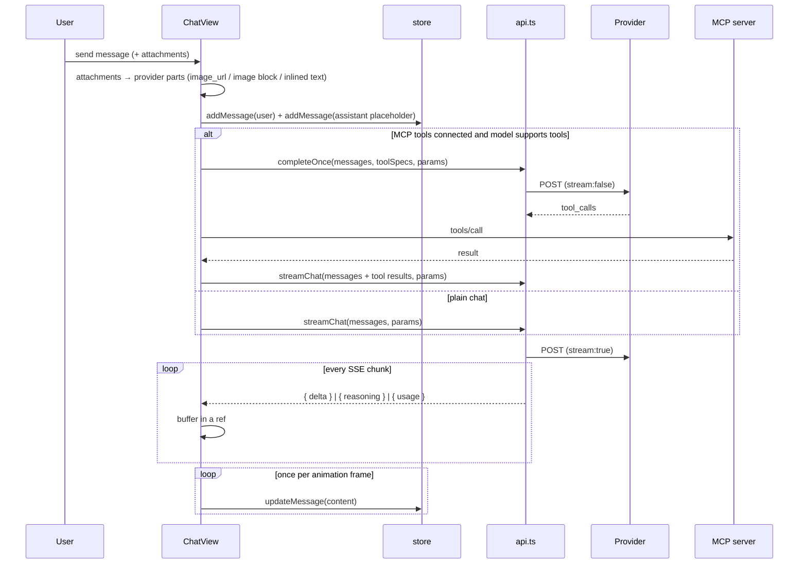

# Architecture

How Sarvam Studio is put together, and why it is built this way.

The constraint that shapes everything: **there is no backend**. Every request leaves the user's device
straight to the provider, every byte of state lives in the browser (or the app's WebView), and every
secret is encrypted on the client. Features that would need a server — shared history, team keys, usage
billing, a proxy for CORS-hostile APIs — are out of scope by design.

Version 3 adds one more constraint that drove most of the UI work: **it has to stay smooth on a
mid-range phone**, while streaming, with images on screen and a long transcript.

---

## 1. Layers

```
┌──────────────────────────────────────────────────────────────┐
│  Presentation                                                │
│  App.tsx · Sidebar · ChatView · ModelPicker · SettingsOverlay│
│  panels/{Appearance,Chat,Models,Providers,Mcp,Data}          │
├──────────────────────────────────────────────────────────────┤
│  State                                                       │
│  lib/store.tsx — one React context, useCallback actions,     │
│  localStorage persistence with quota handling                │
├──────────────────────────────────────────────────────────────┤
│  Domain                                                      │
│  lib/catalog.ts (providers, models, free presets)            │
│  lib/api.ts     (request shapes, SSE, attachments, tools)    │
│  lib/attach.ts  (image downscale, text extraction)           │
│  lib/mcp.ts     (JSON-RPC client)                            │
│  lib/secureStore.ts (encryption)                             │
├──────────────────────────────────────────────────────────────┤
│  Platform                                                    │
│  fetch · SSE · canvas · WebCrypto · IndexedDB · localStorage │
│  Android Keystore (via JS bridge, APK only)                  │
└──────────────────────────────────────────────────────────────┘
```

No state library. The app has one store because the state is genuinely one object graph: settings affect
model selection, model selection determines which key is used, keys and MCP servers are shared across
conversations.

---

## 2. Data model

```ts
Conversation { id, title, messages[], modelId, createdAt, updatedAt,
               pinned?, archived?, params?: Partial<ModelParams> }

ChatMsg {
  id, role: "user" | "assistant", content, createdAt,
  modelId?, error?, reasoning?, toolRuns?, usage?, stopped?,
  attachments?: Attachment[]
}

Attachment {
  id, kind: "image" | "text", name, mime, size,
  dataUrl?,          // images, already downscaled
  text?,             // text files, capped at 40k chars
  width?, height?
}

ModelParams {
  temperature, topP, topK, maxTokens,
  presencePenalty, frequencyPenalty, seed, stop[],
  reasoningEffort, jsonMode
}
```

Everything is JSON-serialisable and lives in localStorage under versioned keys (`sarvam.v2.*`). Secrets
live separately, encrypted (see §7).

---

## 3. Request lifecycle



Two details worth calling out:

**Tool planning is a separate, non-streaming round.** Mixing tool-call detection with token streaming
means buffering partial JSON arguments and hoping the model finishes before the user sees anything. One
cheap non-streaming request decides whether tools are needed; if the model answers directly, that answer
is used as-is and no second request is made.

**Reasoning is a separate channel.** Sarvam v2 (`reasoning_content`), DeepSeek and Anthropic
(`thinking_delta`) emit thinking alongside content. It accumulates into `msg.reasoning` and renders in a
collapsed block.

---

## 4. Rendering performance

Three changes, in order of impact:

1. **No compositing layers.** v2 used `backdrop-filter` on every panel plus three animated gradient
   blobs. On a phone that is a full-screen blur re-composited on every scroll frame. v3 uses solid
   fills, 1px borders and one static background gradient. Nothing in the UI requires a layer.
2. **Frame-batched streaming.** The SSE loop appends to a ref (`pendingContent`) and schedules a
   `requestAnimationFrame` flush. A 2000-token answer becomes ~60 React updates per second at most,
   instead of one per token. `updateMessage` copies the message array, so this is the difference between
   smooth and janky on long chats.
3. **Memoised, self-skipping rows.** `MessageRow` is wrapped in `React.memo` with stable callbacks (all
   handlers take an id and read from a ref), so only the streaming row re-renders. Each row also carries
   `content-visibility: auto` with an intrinsic size, so off-screen messages skip layout and paint
   entirely.

The composer, markdown and code blocks are the only expensive nodes, and markdown is re-parsed only for
the row being streamed.

---

## 5. Attachments

`attach.ts` runs entirely in the browser:

- **Images** — read as a data URL, decoded, drawn to a canvas at `min(1, 1280 / max(w, h))`, re-encoded
  (JPEG q=0.82, PNG preserved for transparency). A 6 MB photo lands at ~150 KB, which keeps both the
  request and localStorage sane.
- **Text-like files** — read as text, capped at 40,000 characters.

`api.ts` then shapes them per provider:

| Provider family | Images | Text files |
| --- | --- | --- |
| OpenAI-compatible (Sarvam, OpenAI, Gemini, custom) | `{ type: "image_url", image_url: { url } }` | inlined as `--- file: name ---` blocks inside the text part |
| Anthropic | `{ type: "image", source: { type: "base64", media_type, data } }` | same |

Incoming images are the mirror image: `` in Markdown, array content parts, or `images[]` are all
converted to Markdown image syntax, which the renderer turns into a real `` with a lightbox.

Storage: attachments are persisted with the message. `persistChats` writes, and if the write throws
(quota), it strips every image `dataUrl` and retries; if that still fails it keeps the newest 30
conversations. Losing a thumbnail beats losing history.

---

## 6. Provider adapters

`api.ts` normalises five families into two wire formats.

| Provider | Format | Auth | Notes |
| --- | --- | --- | --- |
| Sarvam AI | OpenAI chat-completions | `api-subscription-key` (+ `Authorization`) | v1 for `sarvam-105b*`, v2 for open-weight models |
| OpenAI | OpenAI chat-completions | `Authorization: Bearer` | sends `max_completion_tokens` for reasoning models |
| Anthropic | Messages API | `x-api-key` + `anthropic-version: 2026-10-21` + direct-browser-access | system prompt hoisted; `max_tokens` mandatory |
| Google Gemini | OpenAI-compat layer | `Authorization: Bearer` | same body, different host |
| Custom / presets | OpenAI chat-completions | configurable header + prefix | Ollama, vLLM, OpenRouter, Groq… |

Endpoint resolution order: **model-level override → custom provider config → provider default**.

### Parameter mapping

| Param | OpenAI-compatible | Anthropic |
| --- | --- | --- |
| temperature / top_p | `temperature` / `top_p` | same |
| top_k | `top_k` | `top_k` |
| penalties | `presence_penalty` / `frequency_penalty` | not supported (omitted) |
| seed | `seed` | not supported (omitted) |
| stop | `stop` (max 4) | `stop_sequences` |
| reasoning | `reasoning_effort` (Sarvam v2 maps medium→high, high→max) | adaptive thinking by model |
| JSON | `response_format: { type: "json_object" }` | not sent |

Zero/empty values are omitted rather than sent, so providers that reject `top_k: 0` or an empty `stop`
array never see them.

### Streaming parser

One hand-written SSE reader for both shapes: buffers on newlines, keeps a partial tail between `read()`
calls, tolerates malformed chunks, and maps OpenAI deltas / Anthropic `content_block_delta` events.
Abort is cooperative — an `AbortController` cancels the fetch and the message is marked `stopped`, not
`error`.

### Error mapping

401/403 → "check the key", 402 → "out of credit", 404 → "this model ID may have been retired",
413 → "payload too large", 429 → "rate limit", 400/422 → provider message, 5xx → "temporarily
unavailable". A network failure is reported as a CORS-or-network problem with the proxy hint.

---

## 7. Security model

| Threat | Mitigation |
| --- | --- |
| Someone reads localStorage | Keys are AES-GCM ciphertext; the key is a non-extractable `CryptoKey` in IndexedDB (web) or in the Android Keystore (APK) |
| Storage dump copied elsewhere | Useless without the device key / keystore |
| Key leaks into a backup | Exports omit keys entirely |
| Key leaks into logs or URLs | Only ever read into request headers |
| Malicious model output | Markdown → React elements; links open with `rel="noreferrer noopener"` |
| MCP server exfiltrating keys | MCP requests carry only that server's own auth headers |
| Tool call running silently | Auto-approve is opt-in per server |

Not mitigated, and stated in the UI: malicious code on the page, a hostile extension, or an attacker
holding the unlocked device.

---

## 8. Design system

Every visual property is a CSS custom property on `:root`, written by the store when settings change:

```
--accent, --accent-2        rgb triplets, so Tailwind's /alpha works
--surface-mix, --border-strength
--radius, --font-scale, --chat-width
--bg-0, --bg-1, --panel, --panel-2, --fg, --muted, --border
```

Changing the accent, contrast or radius repaints the app without re-rendering the React tree.

Surfaces are three classes: `.glass` (cards — the name is historical), `.glass-soft` (nested),
`.glass-hi` (composer, modals). All three are now solid fills with a border and a small shadow. Menus
(`.popover`) are fully opaque, because a menu you can read the page through is a menu you cannot read.

Markdown renders to React elements, never HTML strings, so a model cannot inject markup.

---

## 9. Android shell

The APK is a WebView host, not a rewrite:

- UI served from `file:///android_asset/www/` — no server, no localhost port.
- `allowUniversalAccessFromFileURLs` + `allowFileAccessFromFileURLs` are enabled **on purpose**: they
  are what let the page call provider APIs and MCP servers directly. A real origin would re-introduce
  CORS and force a relay server.
- `usesCleartextTraffic` + `MIXED_CONTENT_ALWAYS_ALLOW` so a local MCP bridge on `http://localhost` works.
- `SecureBridge` exposes encrypt/decrypt over `@JavascriptInterface`, backed by an AES-256-GCM key in the
  Android Keystore. `secureStore.ts` prefers it, then WebCrypto, then obfuscated localStorage.
- `windowSoftInputMode=adjustResize` keeps the composer above the keyboard.
- Built without Gradle: `aapt2 → javac → d8 → zipalign → apksigner`.

---

## 10. Testing

No test framework is bundled — the project stays dependency-light — but the risky parts were verified
with throwaway harnesses:

- **Logic:** mocked `fetch` returning SSE streams and JSON-RPC responses; delta accumulation, usage
  events, tool-call parsing, status→message mapping, MCP handshake ordering, secret round-trips.
- **Browser:** Puppeteer against real Chromium — attach an image and a text file, inspect the outgoing
  request body (image part count, `top_k`, `presence_penalty`, `seed`), assert the streamed reply and the
  returned image render, reload and assert persistence.
- **Presets:** pressing Add on Ollama creates the provider, imports its models, and they appear in the
  picker.
- **APK:** `apksigner verify` (v1/v2/v3), `aapt2 dump badging`, and the packaged assets run from a
  `file://` origin.

Not covered: a boot on real Android hardware, and live calls to each provider (needs keys).

---

## 11. Decisions and trade-offs

**Flat over glass.** Glass looked good in a screenshot and cost real frames. Readability and scroll
smoothness won; the accent colour and radius still give it a personality.

**Frame-batched streaming over per-token state.** A token-by-token React update is the obvious
implementation and the wrong one at 60+ tokens/second.

**Refs for async reads.** Regenerate and edit-and-resend continue after a state change; reading from a
`storeRef` avoids acting on a stale closure (a real bug in v2).

**Editable catalogue over a hardcoded list.** Vendors retire models constantly (Sarvam removed
`sarvam-m` outright). A user-editable catalogue with a documented "removed" list degrades gracefully.

**Presets over a generic "custom provider" form.** A URL, an auth header and a model list is three
chances to get it wrong. One click, then ↻ for the live list.

**Encrypted-at-rest keys over "don't store them".** Re-entering a key on every launch makes a chat app
unusable. The compromise is explicit, and the opt-out exists for shared machines.

**file:// + universal access in the APK over a local server.** A localhost server would give a real
origin but reintroduce CORS for every provider call.
